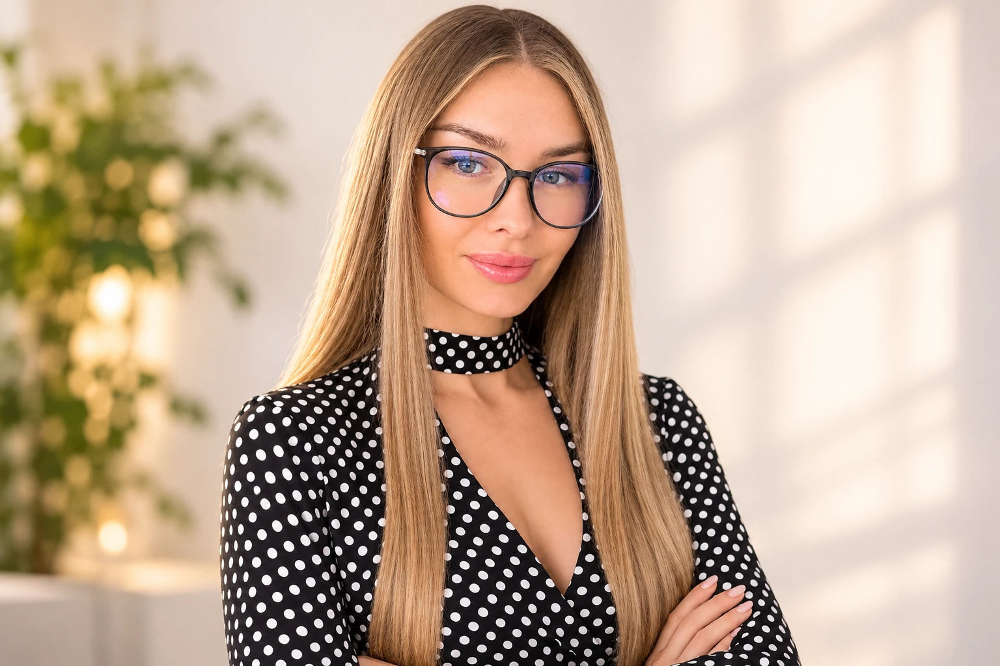

# Ольга Сусленникова

**Клинический психолог · гипнолог · мастер и тренер НЛП · специалист по системным семейным расстановкам**

> Иногда кажется, что вы ходите по кругу: в отношениях повторяется один и тот же сценарий, решение не находится, а привычные способы справляться больше не помогают. В такой момент полезно остановиться, внимательнее посмотреть на ситуацию и понять, какой шаг может стать следующим.

Меня зовут Ольга Сусленникова. Более 15 лет я работаю с людьми, помогая разбираться в сложных жизненных ситуациях, исследовать привычные реакции, налаживать отношения и находить опору для дальнейших решений.

В основе моей профессиональной работы — образование по клинической психологии. В зависимости от запроса я сочетаю системный взгляд, элементы коучинга, НЛП и мягкие трансовые техники. Для меня важно не предлагать универсальные ответы, а внимательно разобраться в вашей ситуации и понять, какой формат помощи действительно уместен.

## С чем можно обратиться

Можно обсудить отношения в паре, конфликты и дистанцию, отношения с родителями и близкими, расставание и перемены, повторяющиеся ситуации, тревогу и внутреннее напряжение, личные границы, самооценку или сложный жизненный выбор.

Необязательно заранее точно формулировать запрос. Иногда достаточно описать, что сейчас беспокоит и что хотелось бы изменить.

## Как проходит работа

Системная семейная расстановка позволяет посмотреть на ситуацию со стороны и исследовать отношения, переживания и повторяющиеся сценарии. Встреча начинается с обсуждения запроса. Затем мы выбираем подходящий формат, исследуем ситуацию и в конце обсуждаем наблюдения и возможные дальнейшие шаги.

Это не способ устанавливать факты о других людях или предсказывать события. Результат и впечатления от работы индивидуальны. Вопросы здоровья и зависимости требуют отдельной оценки профильного специалиста: расстановки не заменяют медицинскую диагностику и лечение.

## Форматы встреч

- **Индивидуально онлайн** — работа с запросом на фигурках в Zoom.
- **Группа онлайн** — встреча в Zoom с участием заместителей.
- **Группа очно** — групповые встречи в Санкт-Петербурге.

Перед записью можно обсудить запрос и выбрать подходящий формат. Первая диагностическая встреча помогает познакомиться, прояснить ситуацию и понять, какие дальнейшие шаги имеют смысл.

## Начать разговор

Напишите мне в Telegram. Можно коротко рассказать, что привело вас к поиску помощи, задать вопрос о формате или обсудить запись. Дальше мы определим, подходит ли вам такой способ работы и с чего лучше начать.

**[Написать Ольге в Telegram](https://t.me/olga_styleofmind)**

[Официальный сайт](https://styleofmind.github.io/) · [Как проходит расстановка](https://styleofmind.github.io/how-family-constellations-work.html) · [Онлайн-форматы](https://styleofmind.github.io/online-family-constellations.html) · [Группы в Санкт-Петербурге](https://styleofmind.github.io/group-constellations-spb.html)
